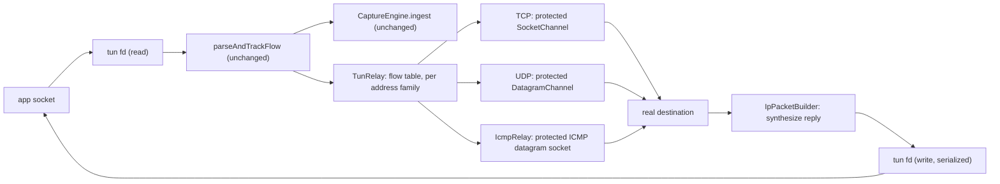

# Transport / Packet-Core Plan — requestr v5.9

> **TL;DR:** Build a dual-stack userspace relay (TCP, UDP and ICMP over IPv4+IPv6) so the VPN_TUN tier stops blackholing all device traffic, make `TlsHandshakeState.FAILED` a real observed state, decrypt QUIC 1-RTT through a key-log registry requestr legitimately populates from its own MITM and SDK planes so HTTP/3 rows are real, and replace destructive Room migration with one real migration that adds `connectionId` and absorbs the app scope's new tables.

## Scope

Twelve work items, all inside `interception/` plus the Room schema. This scope does not own SDK internals, browser/runtime, or app-level product gaps — but it **owns the key-log registry interface** that the SDK scope produces into, and **owns the single schema version bump** the app scope defers to.

| # | Item | Current state (grounded) | Target |
|---|---|---|---|
| 1 | VPN_TUN blackhole | `PacketPump` takes `output: FileOutputStream` (line 42) and never writes to it | Dual-stack relay: TCP + UDP + ICMP, IPv4 + IPv6 |
| 2 | `TlsHandshakeState.FAILED` | Only writers are `CaptureEngine.kt:186` (`CLIENT_HELLO`) and `MitmProxyEngine.kt:625` (`ESTABLISHED`) | Alert records + `SSLHandshakeException` + RST/timeout, with a reason column |
| 3 | P2 / HTTP-3 QPACK | `QpackDecoder.decode()` has no production call site | Real HTTP/3 rows via MITM/SDK-sourced key material |
| 4 | Schema honesty | `version = 8` + `.fallbackToDestructiveMigration(dropAllTables = true)`; no `connectionId` | Version 9, real `Migration`, no data wipe |

## Item 1 — the blackhole, and why it is a full outage

The read loop (`PacketPump.run()`, lines 95–129) does `input.read(buffer.array())` then `parseAndTrackFlow(buffer.array(), read)`. That function (lines 135–151) parses, PCAPs, calls `captureEngine.ingest(...)`, and returns. `output` appears exactly twice in the entire 370-line file: the constructor parameter at line 42, and a doc comment at line 79 that is about `PacketCaptureEngine`, not the tun.

Because the builder sets `.addRoute("0.0.0.0", 0)`, every IPv4 packet from every routed app is swallowed. The tun's `.addDnsServer("1.1.1.1")` / `.addDnsServer("8.8.8.8")` are inert — DNS queries are dropped like everything else.

`VpnService.protect(...)` also appears nowhere in `RequestrVpnService.kt`. Without it, a relay socket is itself routed into the tun and loops.

## Item 1 — three real bugs found while grounding

1. **Selected-apps mode has never worked.** `startCapture()` calls `builder.addDisallowedApplication(packageName)` unconditionally, then in `AppFilterMode.SELECTED_APPS` also calls `addAllowedApplication(pkg)`. `VpnService.Builder` accepts an allowed set *or* a disallowed set, never both, and throws `UnsupportedOperationException` when mixed. The existing broad `catch (t: Throwable)` funnels this into the generic `fail("Capture failed to start: ...")`, which is why it reads as a vague failure rather than a specific defect.

2. **`TcpReassembler.prune()` has a dead predicate.** Its second statement compares `System.currentTimeMillis() - s.establishedAt` (a duration, in the thousands of ms) against `cutoff = System.currentTimeMillis() - idleTimeoutMs` (an absolute epoch value, ~1.7e12). The predicate is never true, so idle-but-unclosed streams are never pruned by it.

3. **`establishedAt` is really a last-activity stamp.** `feedTcp` sets `stream.establishedAt = System.currentTimeMillis()` on every accepted write, yet `CaptureEngine.persistTcpConnection` writes it into `TcpConnectionEntity.establishedAt`. Splitting it into `establishedAt` (set once) and `lastActivityAt` is a prerequisite for correct pruning and correct lineage timestamps.

## Item 1 — ICMP is relayed, not labelled

Per the decision, ICMP gets a real echo path in its own class so it cannot destabilize TCP/UDP.

Primary path: `Os.socket(AF_INET, SOCK_DGRAM, IPPROTO_ICMP)` (and `AF_INET6`/`IPPROTO_ICMPV6`). `OsConstants.IPPROTO_ICMP` and `IPPROTO_ICMPV6` are API 21+, comfortably under the project's `minSdk 24`. This is the unprivileged ping-socket path, gated by the kernel's `ping_group_range`; it does not need `CAP_NET_RAW`.

Fallback path — **one mechanism correction.** The decision named `InetAddress.isReachable()` on a protected socket. That specific combination is not achievable: `isReachable` creates its probe socket internally inside the platform, so there is no descriptor for us to hand to `protect()`. An unprotected probe would be routed straight back into our own tun and be re-handled by our own relay, which is a loop, not a reachability test. Android documents `isReachable` as ICMP echo first, then a TCP connect to port 7 — so the plan implements that same probe ourselves on a `SocketChannel` we own and protect. Same fidelity, and actually protectable. This keeps the decision's intent (a working reachability determination that produces a real echo reply) with a mechanism that functions.

Only when both the ping socket and the owned probe fail does the relay count the packet as unrelayable and surface it. That is a genuine runtime state, not a documented limitation.

## Item 1 — IPv6 is implemented, generic over address family

The relay is built generic over address family rather than forked. Two grounded details shape the work:

- **Address strings are not canonical today.** `PacketPump.parseIpv6` (lines 296–309) and `TcpReassembler.feedIpv6` both build addresses via `packet.copyOfRange(8, 24).joinToString("") { "%02x".format(it) }` — a bare 32-hex-char string. `InetAddress.getByName(...)` cannot parse that, so the relay needs a real formatter/parser pair. Existing flow keys must keep their current string form so `TcpConnectionEntity.connectionId` values stay stable.
- **`parseIpv6` assumes no extension headers.** It reads `nextHeader` at byte 6 and then assumes the transport header begins at offset 40. Any hop-by-hop (0), routing (43), fragment (44) or destination-options (60) header breaks that. Walking the chain is in scope.

**One named IPv6 sub-case, per the decision's instruction to report specifics rather than drop the family:** *fragmented* IPv6 datagrams (next header 44) carry no transport header in the non-first fragment, so the 5-tuple is unknowable until reassembled. The plan handles this with a bounded, TTL-pruned fragment reassembly buffer (same shape as the existing flow tables) rather than dropping them, because silently dropping fragments would recreate the blackhole in miniature. This is a decision taken, not a blocker — flagged only so it can be overridden. The same reassembly serves IPv4 fragmentation, which `parseIpv4` also does not handle today (it only requires `length >= ihl + 4`).

## Item 2 — making FAILED real

Three genuine failure signals, none read today:

1. **TLS alert records.** `TlsRecord.contentTypeName` already maps `21 -> "alert"`, but `TlsDecoder`'s whole public surface is `looksLikeTls` (line 27), `extractSni` (57), `versionName` (132), `parseClientHello` (148). No alert parser exists — which is precisely why nothing can set FAILED.
2. **MITM upstream failure.** `MitmProxyEngine.handleClient` runs both `startHandshake()` calls under one broad `catch (e: Exception)` that only logs. An `SSLHandshakeException` there is a definitive failed handshake.
3. **RST or close mid-handshake.** `TcpReassembler` already sets `closed = true` on FIN|RST. A stream that is `isTls` and closes without reaching ESTABLISHED is a failed handshake — distinguishable from one that never sent a ClientHello.

This retires two shipped apologies: `ConnectionLineage.kt` lines 222–224 (above `success = tls.handshakeState != "FAILED"` — "can only ever be true given that a row exists at all") and `VisibilityAnalyzer.kt` line 73's unconditional `limitingReasons` string, which states its own `tlsFailedReported` counter "is expected to always read 0".

## Item 3 — QUIC 1-RTT: stop being a passive observer

`QuicCrypto`'s class doc (lines 22–26) is correct that Handshake and 1-RTT secrets need "the private key material of one endpoint" — a passive observer genuinely cannot compute the ECDHE shared secret, and implementing the TLS 1.3 key schedule alone does not change that, because the schedule needs that secret as *input*.

So requestr stops being passive on the planes it controls. It already terminates TLS in `MitmProxyEngine`, and the SDK plane sits inside the app's own process. Both legitimately hold key material.

`TlsKeyLogRegistry` (this scope owns it) is the canonical source, with three producers:

| Producer | Owner | Mechanism |
|---|---|---|
| MITM leg | this scope | `MitmProxyEngine` registers secrets for connections it terminates |
| SDK plane | SDK scope | third-party decryption SDK exports TLS key material into the registry's frozen ingest interface (`record(label, clientRandom, secret)`) |
| `SSLKEYLOGFILE` import | this scope | user-supplied NSS-format keylog file import |

The registry's ingest interface is defined in task 5 below so the SDK scope is unblocked early. When no key exists for a connection, the QUIC row is honestly marked undecrypted using the existing `wasDecrypted` / `isUndecoded` fields on `CapturedTrafficEntity` — a real runtime state, visible in the UI, not a comment.

## Item 4 — one schema bump, one migration, no data wipe

`RequestrDatabase` is `@Database(version = 8, exportSchema = false)` with `.fallbackToDestructiveMigration(dropAllTables = true)` at line 70, under a comment promising real migrations post-release. `CapturedTrafficEntity` (Entities.kt lines 17–47) has no `connectionId`, which is exactly why `CapturedTrafficDao.getByHostInWindow` exists and why `ConnectionLineage.httpSteps()` matches HTTP to connections through `HTTP_WINDOW_MS = 30_000L`.

This scope owns the version number and the migration. `MIGRATION_8_9` carries:

- `captured_traffic.connectionId TEXT` + index — exact lineage join.
- `tls_sessions.failureReason TEXT`, `tls_sessions.failedAt INTEGER` — the honest "why" behind FAILED.
- **A delimited app-scope section** creating five new tables: `notes`, `note_folders`, `custom_tools`, `chat_messages`, `chat_providers`. Real DDL is now written into the plan from `plan-app.md`'s **H1** column lists. The app scope owns those column definitions; this scope owns the version number and `Migration` objects. DDL must be cross-checked against their `@Entity` declarations before landing, since Room throws on any mismatch at open time. `chat_providers` deliberately has no API-key column.

The real `Migration` object **fully replaces** `.fallbackToDestructiveMigration(dropAllTables = true)`. Upgrading from v8 preserves all user data; today it would wipe every table.

## Decisions applied

| Decision | Choice |
|---|---|
| ICMP | Real relay via unprivileged ping socket, with an owned+protected TCP:7-style probe as fallback. Isolated class. |
| QUIC keys | Key-log registry as canonical source; MITM + SDK + `SSLKEYLOGFILE` producers. Interface owned here and **now frozen** as an explicit signature block so the SDK scope binds to a fixed contract. |
| IPv6 | Implemented, relay generic over address family; bounded fragment reassembly. |
| Lineage joins | **Exact `connectionId` joins only.** The 30s `getByHostInWindow` fallback is removed from the lineage path and must not be re-added — a time window can attach a plausible-but-wrong row and fabricate a causal chain. Resolved in favour of the runtime scope's W6, which owns the consumer and adds `unattachedHttpRows`. |
| UI | Design mockups are the visual spec for task 14. **All three surfaces are covered** — 12 mockups in `/code/.plans/designs/`, each light/dark: 5 relay-health states, 3 TLS (mixed rows + two FAILED reasons), 4 HTTP/3 (row indicators + decoded/QUIC-only/undecrypted). No layout to invent. |
| Schema | This scope owns version 9 and the single migration, absorbing five app-scope tables. |
| Ordering | Confirmed: this scope lands first; app scope applies a surgical diff on top of the rewritten files. |
| Relay architecture | New classes in `interception/tun/`, not routed through `MitmProxyEngine` — fixes all traffic, not just TCP:443, and drags no CA requirement into a tier that has none. |
| No NDK | `app/build.gradle.kts` has no `externalNativeBuild`/`cmake`/`ndk`; pure Kotlin using `java.nio` and `android.system.Os`. |

## Blocking questions

**None.** All four original questions are decided, all five handoffs are resolved, and the lineage-fallback disagreement with the runtime scope is settled in W6's favour.

Handoffs resolved: Section B DDL folded in from `plan-app.md` H1; `TlsKeyLogRegistry` frozen in task 5; the `LocalApiServer` `connectionId = null` one-liner stays in this scope; mockups for all three UI surfaces are on disk; land order confirmed.

One thing to watch rather than a blocker: if the runtime scope's `unattachedHttpRows` is routinely non-zero after this scope's threading lands, that signals a **gap in the threading**, not an acceptable steady state. Only genuinely identity-less producers (SDK `/api/observe`, HAR imports) belong there.

Two items are flagged for awareness only, both with a chosen approach that does not block implementation:

- The `InetAddress.isReachable()` mechanism correction described under item 1 (platform-internal socket cannot be protected; equivalent owned probe used instead).
- Fragmented IPv6 datagrams as the one named sub-case, handled with bounded reassembly rather than dropped.

On verification honesty: the tun relay, IPv6 relay, and ICMP ping-socket path **cannot** be validated end-to-end on Redroid (no kernel TUN). Task 14 requires that gap to be stated in `TODO_v5.md` and `AUDIT_REPORT.md`, not just in this plan.
