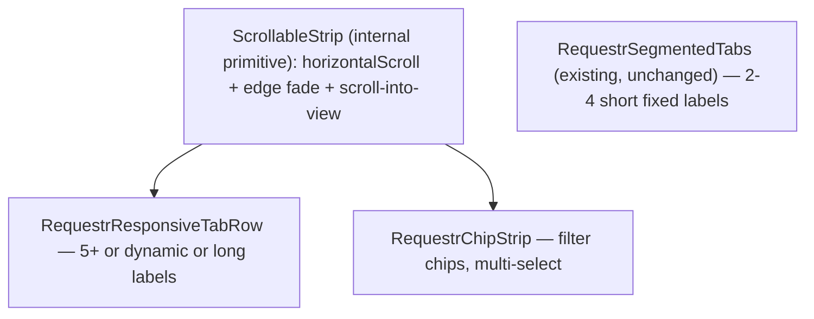

# requestr Interceptor UI: Responsive Tabs, Capture Workspace, and Complete Screens

> **TL;DR:** Replace every compressing/wrapping tab site with one scrollable, intrinsic-width tab primitive, then build out the 15 interceptor surfaces from the approved mockups as complete, theme-native Compose screens on the existing navigation graph.

## Goals

Every tab label stays on one line at its natural width. Nothing is squeezed to equal width, nothing wraps, and when the row is wider than the screen it scrolls sideways with the selected tab pulled into view.

The current app theme keeps control of every colour, shape, blur mode, density and motion value. The 30 mockups are read as design intent, not as production layout.

Every screen named below ships finished. No placeholder text, no "coming soon", no empty function bodies. Where a capability genuinely does not exist on a device (HTTP/3 without session keys, for example) the screen says so honestly, which is exactly what the mockups already show.

## Current behaviour: what is broken

| Pattern | Where | Problem |
|---|---|---|
| Material 3 `TabRow` | `ApiTestrScreen.kt:463`, `ApiTestrScreen.kt:834`, `InterceptScreen.kt:2016`, `InterceptScreen.kt:4738` | Equal-width tabs, labels wrap or compress, no horizontal scroll |
| `RequestrSegmentedTabs` | `CommonComponents.kt:1474` | Correct intrinsic sizing, but designed for 2–4 items; starts truncating past 4 |
| Ad-hoc pill rows | `ApiTestrScreen.kt:2654`, `:2840`; `InterceptScreen.kt:513`, `:2939`, `:3724`, `:4016`; `ToolsScreen.kt:390` | Bespoke `Box` + `clickable` + `horizontalScroll` copies that bypass the design system entirely |
| Dead imports | `FlowScreen.kt:57–59` | `TabRow` imports with no `TabRow` in the file |

Two concrete symptoms: the ApiTestr response tab set flips between 5 and 6 items at runtime and the layout jumps; `Provenance (6)` compresses the whole Intercept protocol row.

## Proposed component tier system

One internal scroll primitive, three public wrappers, one rule for choosing between them.

| Situation | Component |
|---|---|
| Mutually exclusive view switch, 5+ items, dynamic count, or long labels | `RequestrResponsiveTabRow` (new) |
| Mutually exclusive switch, 2–4 short fixed labels that truly fit | `RequestrSegmentedTabs` (keep as-is) |
| Filtering, multi-select, or "All + N values" | `RequestrChipStrip` wrapping the existing `RequestrFilterChip` |

Keeps the existing compact controls untouched: Notes format selector, Settings density selector, ApiTestr Request/Response toggle.

### Mechanics that satisfy the non-negotiables

Tab width is `wrapContentWidth()` plus padding. `Modifier.weight` never appears. Labels are `maxLines = 1, softWrap = false` and truncation is off by default.

The row always lives inside `horizontalScroll`, so children are measured with unbounded width and can never be compressed. Whether the row actually scrolls is read from `scrollState.maxValue > 0` — real measurement, not the screen-width estimate the audit proposed. That same flag drives the trailing fade and chevron affordance.

Selection scroll target, dynamic index clamping, and the spoken accessibility label are pure functions in a helper file so they are unit-testable without Compose, matching how `bottomOverlayInsetFor` and `statusCodeBadgeText` are already tested in this repo.

Reduced motion, density, glass mode, accent and haptics all route through the existing `scaledTween` / `ProvideDensityConfig` / `resolveGlassSurface` / `rememberAppHapticFeedback` plumbing.

## Screens to build

The 15 sections in `/code/.plans/designs/design-plan.json` are the required surface list. All of them land under a new `ui/screens/capture/` package, reached from the existing `intercept` route.

| Surface | Tab collection | Source mockup |
|---|---|---|
| Capture workspace | Traffic · Connections · TLS sessions · DNS queries · QUIC / HTTP3 · Diagnostics (6) | `capture-workspace` |
| Transaction inspector | Overview · Headers · Body · Cookies · Timing · TLS · HTTP/2 frames · Raw / Hex (8, protocol-adaptive) | `inspector` |
| Session workspace | Current capture · Imported HAR · Pinned review · ＋ New session | `session-workspace` |
| Rule library | folder sidebar + ordered rule list | `rule-library` |
| Rule editors ×5 | 4-step sidebar; Mock adds Body · Headers · Delay | `gateway/mirror/rewrite/mock/throttle-editor` |
| Breakpoint workspace | Headers · Body · Cookies · Raw / Hex (4) | `breakpoint-workspace` |
| WebSocket viewer | Messages · Handshake · Frames · Timing · TLS (5) + compact Text · Hex | `websocket-viewer` |
| SSE viewer | Events · Request · Response headers · Timing · Raw stream (5) + compact Text · JSON · Hex | `sse-viewer` |
| gRPC viewer | Messages · Metadata · Trailers · HTTP/2 frames · Timing · Raw / Hex (6) + compact Hex · Raw | `grpc-viewer` |
| HTTP/3 viewer | Connection · Packets · Streams · QPACK · TLS keys · Raw / Hex (6) | `http3-viewer` |
| Diagnostics | check list + remediation detail | `diagnostics` |

Plus the dossier-named companions: export panel (HAR / cURL / snippets), replay control, certificate management, network throttle presets, script editor, and the Settings capture-tier expansion.

## Navigation

Keep the `intercept` route and the six-item nav pill exactly as they are. Everything new is a depth route under the single existing `NavHost`, which already gives `DEPTH_FORWARD` / `DEPTH_BACKWARD` transitions automatically for non-tab routes. `Screen` gains data-class routes with arguments, following the existing `ToolWorkspace.createRoute` pattern, and `DeeplinkRouter.Routes` gains matching constants.

## Rewrite scope

`InterceptScreen.kt` is 5095 lines with ten bottom sheets inside it. First step is a pure extraction into `ui/screens/capture/` with no behaviour change, which unblocks parallel work on the new surfaces and keeps every migration reviewable. The route, the capture controller wiring and the deep link all stay put.

## Testing approach

Pure-function JVM tests for all scroll, clamp, label and validation logic. Robolectric + `createComposeRule` component tests to prove the non-negotiables directly: unequal labels produce unequal tab widths, row height stays constant as labels get longer, and the last tab is on screen after selecting it. Roborazzi is already wired in `app/build.gradle.kts` but has zero tests today, so this is its first use — baselines at 360dp / 412dp / 600dp, light and dark, 1.0 and 2.0 font scale, LTR and RTL.

## Decisions taken

Tab indicator is a **pill with accent fill**, not the current underline. All 30 mockups use the pill, and it matches the frozen `RequestrSegmentedTabs` and `RequestrFilterChip` tokens, so tabs, segmented controls and chips finally share one visual language. An `Underline` variant stays available but is used nowhere.

No ViewModels. The app currently has zero, and state lives in `object` repositories exposing `StateFlow` plus pure `*Helpers.kt` decision functions. New surfaces follow that, which is also what makes the completeness tests possible.

Overflow detection uses measured scroll extent, replacing the audit's `screenWidth * 0.9f` heuristic, which would have reintroduced estimation error the user explicitly rejected.

## Cross-plan dependency

The protocol/persistence sibling plan (`protocol-persistence-export-summary.md`) normalizes protocol events into dedicated Room tables at schema v19→v20: `websocket_messages`, `sse_events`, `grpc_messages`, `http2_stream_events`, plus `transaction_headers` (order- and duplicate-preserving) and `transaction_timings`.

Today those events exist only flattened into `captured_traffic` — WebSocket as `method = "WS→"` / `"WS←"` rows (`CaptureEngine.kt:843`) and gRPC as synthetic `x-grpc-*` pseudo-headers (`:595–599`). The four protocol viewers, the inspector's Headers tab (needs duplicate `Set-Cookie` preserved) and its Timing tab (needs measured phases, not one `latencyMs`) all read the normalized tables, so those UI tasks must land after that migration. Everything else in this plan — the tab component, all migrations, the capture workspace, sessions, rules, breakpoints, diagnostics — has no such dependency and can start immediately.

## Blocking questions

**1. Do rewrite, mock, breakpoint, throttle and script surfaces ship on-device?** The dossier notes Reqable deliberately gates these to desktop for abuse-prevention and store-policy reasons. This changes scope by roughly seven screens.
- (a) Ship all of them.
- (b) Ship read-only observation surfaces now; gate the traffic-modifying editors behind a developer-mode toggle.
- (c) Drop them from this plan.
- **Recommendation: (b)** — the mockups exist and the rule engine already exists in `RuleEnforcer`, so the work is real, but a single gate keeps store risk contained.

**2. New DataStore keys touch frozen files.** `data/prefs/UnifiedDataStore.kt` and `data/models/AppModels.kt` are frozen to the integration/data owner. Persisting per-screen tab selection, saved filter sets, or column config needs new keys there.
- (a) Prerequisite change from the data owner, blocking the dependent UI tasks.
- (b) Keep the new state in the editable `SettingsDataStore` / `data/interception/` files instead.
- **Recommendation: (b)** where possible, falling back to (a) only for genuinely user-facing persisted preferences.
