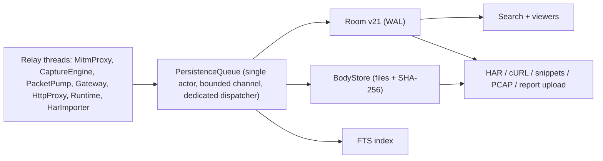

# Protocol, Persistence, Search, Export, and API-Testr HTTP/3

> **TL;DR:** requestr already has deep protocol parsers, PCAP writing, and Cronet, but everything funnels into one flat `captured_traffic` row with fake timings and no real search or export — so this plan normalizes the schema behind a single writer, makes WebSocket/SSE/gRPC/trailers first-class, replaces fabricated timings with measured ones, rewrites HAR/cURL/snippet export, completes PCAP coverage, and wires Cronet as the API-Testr HTTP/3 sending client with real downgrade evidence.

## Scope

This is the protocol + data slice of the larger interceptor-architecture plan. It covers persistence, search, export/import, protocol fidelity (H1 trailers, H2 interception, WebSocket/SSE/gRPC), PCAP, and API-Testr HTTP/3. It does not cover VPN/relay lifecycle, certificate handling, rules UX, or UI implementation.

Repo: `/code/Mahesh953-hub/requestr`, branch `vorflux/fix-audit-gaps` at `b71d61f`.

## What actually exists today (verified in source, not assumed)

The prior audit called several things "missing" that are present. Correcting the record, because the plan must extend them rather than rebuild:

| Area | Real state | What is actually wrong |
| --- | --- | --- |
| PCAP | `interception/packet/PacketCaptureEngine.kt` writes valid classic PCAP (`0xA1B2C3D4`, linktype 228) via `MediaStoreExporter`, wired to the VPN tun lifetime | Native-bridge mode (`PacketPump.runNativeBridgeLoop`) never sees raw packets, so PCAP is silently empty there. No PCAPng, no UID attribution |
| Cronet | `runtime/http/CronetInstrumentation.kt` builds an engine with `enableQuic(true)` and has a working `executeBlocking(...)` | `ApiTestrRepository` never references it (zero grep hits). No protocol-selection field, `CronetCallResult` drops `negotiatedProtocol`, and request bodies are never attached to the `UrlRequest` |
| WebSocket / gRPC persistence | Both are captured and persisted | Persisted as generic `captured_traffic` rows: `method = "WS→"`, payload stuffed in `requestBody`, gRPC metadata smuggled into synthetic `x-grpc-*` pseudo-headers |
| HTTP/2 | Full in-house HPACK + frame parser + `Http2Session` pairing streams into transactions | Observe-only. `MitmProxyEngine` forwards every h2 byte unmodified; rules are never evaluated on h2. `H2Headers` uses `Map`, so duplicate headers are lost |
| HTTP/1.1 chunked trailers | `HttpParser.findTrailerEnd` correctly walks the whole trailer section | Trailers are consumed and discarded, never parsed or stored |
| Codecs (QUIC/QPACK/TLS/protobuf) | Large, well-tested (23 QUIC tests, QPACK conformance, `ProtobufDecoder`) | Keep. Nothing here gets deleted |

## The core problems

**One flat table.** `CapturedTrafficEntity` stores headers as `Map<String,String>` (duplicates collapsed, order lost, `Set-Cookie` mangled), a single `latencyMs`, no trailers, no body files, no content hash, no rule provenance, and no protocol-event children. Every protocol that does not fit gets flattened into it.

**Fabricated timings.** `CapturedTrafficItem` declares `dnsMs/connectMs/tlsMs/waitMs/downloadMs` and nothing in the entire app ever assigns them — the Timing tab and HAR timings are permanently `-1`. Worse, `ApiTestrRepository.executeRequest` invents splits from the total: `dnsTimeMs = (latency * 0.15)`, `tlsTimeMs = (latency * 0.30)`, and so on. `ApiResponseData` also ships fake non-empty defaults (`latencyMs = 142`, `server = "requestr-proxy/2.0"`). All of this must be deleted, not patched.

**No real writer discipline.** 11 separate call sites insert directly into the DAO, two of them inside `runBlocking` on relay threads (`CaptureEngine.kt:630` and `:863`). Room is opened without `setJournalMode`, so WAL is not enabled.

**No real search.** `TrafficSearch` is in-memory, AND-only; `CapturedTrafficDao.search` is `host LIKE '%q%' OR url LIKE '%q%'`. There is no FTS table anywhere, and traffic is absent from `GlobalSearch` entirely.

**Broken export.** `CodeExporter.toHar` emits **invalid JSON** (trailing commas after the last header), is single-entry, has no `log.version`/`creator`/cookies/`postData`/`content.encoding`, and its timings are all `-1`. `toGo` has a Kotlin template bug: `` `$item.requestBody` `` interpolates `item.toString()` then the literal text `.requestBody`. Only 4 languages exist against a 20-target requirement. `HarImporter` hardcodes `sessionId = 0`, ignores `timings` and cookies, and never base64-decodes `content.encoding`.

## Proposed architecture

Schema grows in three reviewable migrations, each with its own migration test, so a failure at any step leaves the DB at the previous good version rather than half-migrated:

| Version | Adds |
| --- | --- |
| v18 → v19 | `transaction_headers` (with `ordinal`, `kind` = request/response/trailer/pseudo — duplicate- and order-preserving), `transaction_timings` (dns/connect/tls/send/wait/receive, nullable, no `-1` sentinels), `applied_rules` provenance table, body-reference columns on `captured_traffic` (`filePath`, `sha256`, `preview`, `storedBytes`) |
| v19 → v20 | `websocket_messages`, `sse_events`, `grpc_messages`, `http2_stream_events`; one-time reverse-migration of the existing flattened `WS→`/`WS←` and `x-grpc-*` rows into them |
| v20 → v21 | FTS index table + eager population, `intercept_rules.order_index` / `folder_id`, `rule_folders` |

Bodies follow the dossier's spill policy: under `HttpBodyDecoder.MAX_STORED_BODY_BYTES` (already 2 MiB) stay inline as BLOB, larger go to `filesDir/captures/<sessionId>/<trafficId>.<req|res>.bin` with metadata, SHA-256, and a text preview in the row. Session delete and pruning remove the files.

## Key decisions needed

1. **FTS5 or FTS4.** The dossier specifies FTS5 with `tokenize='unicode61'`, but `minSdk = 24` and Android's bundled SQLite does not guarantee FTS5 on all devices; Room 2.7.0 has `@Fts3`/`@Fts4` only, no `@Fts5`. Recommendation: Room-native `@Fts4` with `unicode61` (universally available, compiler-validated, exported schema stays clean), and document the deviation. Alternatives are raw-SQL FTS5 with a runtime probe and FTS4 fallback (two schema shapes, breaks schema validation) or bundling a custom SQLite (large APK cost).
2. **HTTP/2 codec.** Keep the in-house parser behind a fuzz-security budget, or swap the client leg to Netty `codec-http2` (2–4 MB DEX, event-loop threading) while translating its events into the existing `H2Frame`. This changes scope significantly.
3. **20-language snippets.** Port/vendor `curlconverter` (JS-only upstream) versus hand-rolling the 20-target matrix in Kotlin.
4. **Legacy row migration.** Reverse-parse existing flattened WS/gRPC rows into the new tables, or leave them as legacy and only write normalized rows going forward.
5. **Native PCAPng tee.** Whether the Rust `TeeDevice` change (new direct `tun` dependency, replacing `general_run_async` with `tun2proxy::run`) is in scope, since it rebuilds the native ABI for all four Android targets.
6. **Report server.** The dossier marks it optional/later. Confirm inclusion.

## Acceptance gates carried from the dossier

- HAR export byte-equal to a Reqable-exported HAR modulo ids; round-trip import loses nothing.
- Timing values within 10 ms of external `tcpdump` deltas — this is why fabricated timings must be removed, not scaled.
- Snippets compile for at least 5 target languages.
- PCAP opens in Wireshark with flows attributed to UIDs.
- WebSocket echo of 1,000 messages renders in under 2 s; gRPC reflection-based service decodes body and status.
- Fuzz corpus (nghttp2 vectors, malformed frames) crashes nothing.

## UI handoff

Protocol-adaptive viewers (WebSocket message list, SSE event rows, gRPC message/trailer panes, real Timing bars, HTTP/3 detail) need design work in `InterceptScreen.kt` (5,095 lines) and `ApiTestrScreen.kt` (3,877 lines). The main agent should dispatch a design subagent and attach Design-tab artifacts. Existing mockups in `/tmp` (`http3-detail-decoded-light.html`, `rich_response_inspector_light.html`) are useful references.
