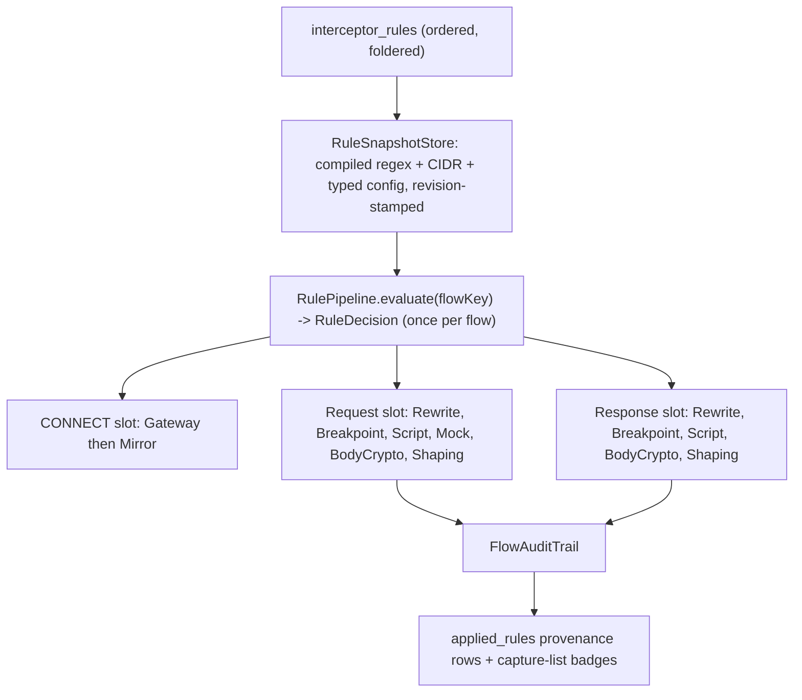

# Rule Engine, Breakpoint, Scripting, Replay, Diff, Throttling, Abuse Safety

> **TL;DR:** requestr has real rule *behaviors* (block, redirect, modify, mock, script, chaos, AES body crypto) trapped inside a flat first-match-wins table with hand-parsed replacement JSON and `runBlocking` DAO reads on the relay thread — so this plan replaces that with a typed rule model, an ordered folder-able library, an eight-slot staged pipeline evaluated once per flow from an immutable snapshot, persisted per-flow provenance, and the four missing capabilities (Host/SNI/CN mirror, breakpoint queue, out-of-process scripting, bounded replay + diff), then retires the flat JSON paths behind parity tests.

## Scope

This is the rule/interception-control slice of the interceptor-architecture plan. It covers the rule domain model and migration, stage semantics and precedence, snapshot evaluation, provenance, mirror, breakpoint, scripting isolation, replay + diff, throttling, and abuse/safety controls.

It does **not** cover relay pool bounding, body spill, per-connection state machines, protocol viewers, HAR/PCAP export, or search — those belong to the persistence/protocol and performance slices.

Repo: `/code/Mahesh953-hub/requestr`, branch `vorflux/fix-audit-gaps` at `b71d61f`.

## What already works and must survive

The prior audit understates the current tree. These are real, tested implementations that the plan **extends** rather than rebuilds:

| Area | Real state today | What is actually missing |
| --- | --- | --- |
| Rule behaviors | `RuleEnforcer.kt` (772 lines) implements all 11 `RuleAction` values including AES body crypto with a fail-closed 502 contract, binary fixtures, and `{{var}}` templating | No stages, no ordering, no folders, no import/export of typed rules, no provenance |
| Script engine | `JsScriptEngine.kt` is genuine Rhino interpreted execution with a wall-clock deadline **and** a 5M-instruction ceiling, plus `StackOverflowError`/`OutOfMemoryError` handling | Runs in-process, no JSON contract, no `onRequest`/`onResponse` lifecycle, no `context.shared`, no kill switch, no console UI |
| Cert mirroring | `RemoteCertificateMirror.kt` already sniffs the real leaf and clones subject + SANs with clamped validity; `CertificateAuthority.issueMirroredLeaf` signs it | No host A → host B mapping, no Host/SNI/CN policy triple |
| Content-Length correctness | `MitmProxyEngine.bodyBytesFor` + `buildMockResponse` always recompute | — |
| Weak-network simulation | `NetworkConditionInjector.kt` applies latency/jitter/loss globally from `SettingsDataStore.networkCondition` | No bandwidth field, no token bucket, no preset table, not a per-rule stage |
| Replay | `ConnectReplay.kt` (CONNECT/TLS probe) and `RepeatReplayDialog` (full HTTP via `ApiTestrRepository`, using the already-unit-tested `computeReplaySchedule`) | Both sequential; dialog state is UI-local, results never persisted, no 255 cap, no queue, no diff |
| Metadata header hygiene | `RuleEnforcer.METADATA_HEADER_KEYS` is a deliberate closed allow-list, not an `x-requestr-` prefix match | Must stay a closed allow-list as new stages add headers |

## The core problems

**Flat model.** `InterceptRuleEntity` has `pattern`, `domain`, `action`, and one nullable `replacementValue` string that eight different code paths parse as ad-hoc JSON with `org.json.JSONObject`. There is no `priority`, no folder, no per-stage schema, and no validation outside UI helpers.

**First-match-wins.** `RuleEnforcer.getMatchingRule` returns the *first* enabled row whose `domain` is a substring of the host **or** whose `pattern` regex matches the URL. `InterceptRuleDao.getEnabledRules()` has no `ORDER BY`, so which rule wins is whatever SQLite returns.

**DB reads on the relay path.** `getMatchingRule` wraps `runBlocking { dao.getEnabledRules() }`. `MitmProxyEngine` calls it twice per flow — once at `handleParsedRequest` (line 916) and again at `handleParsedResponse` (line 1079) — and `CaptureEngine` does the same. Every regex is recompiled on every call.

**No provenance.** `CapturedTrafficEntity` has no applied-rule column, so the capture list cannot show which rules touched a flow.

**Naming collision.** `interception/gateway/GatewayEngine.kt` is **LAN gateway mode** (proxying other devices over a hotspot, persisting to a `CaptureTier.GATEWAY` session). It is not the Reqable "Gateway" rule stage. The new stage must not reuse that class name.

## Proposed architecture

One ordered, folder-able rule list is compiled into an immutable snapshot. Each flow is evaluated **once**, at request time, and the resulting decision is reused on the response side.

### Stage slots and precedence

| Slot | Stage(s) | Where it hooks | Precedence inside the slot |
| --- | --- | --- | --- |
| 1 | **Gateway** (`AccessControlStage`) | `ConnectControl.evaluate` | mode precedence, not list order: `ALLOW_ONLY > BYPASS > BLOCK > SUSPEND > FORCE_DECRYPT` |
| 2 | **Mirror** | `MitmProxyEngine` CONNECT, before cert issue and before `LazyUpstreamConnection` dials | first match wins |
| 3 | **Rewrite** | `handleParsedRequest` / `handleParsedResponse` | redirection → replacement → modification; **max one redirection**; all matching modifications apply in list order |
| 4 | **Breakpoint** | after rewrite, before script | first match wins |
| 5 | **Script** | isolated process, after breakpoint | all matching scripts run in list order; `null` return aborts and short-circuits |
| 6 | **Mock** | after script, short-circuits upstream | first match wins |
| 7 | **BodyCrypto** | last mutation before the wire (request) / before client write (response) | first match wins, fail-closed |
| 8 | **Shaping** | relay copy loops + connect | throttle first, then chaos; first match wins per kind |

`OBSERVE` is a tenth stage with no effect, so today's `LOG_ONLY` rows migrate without inventing behavior.

### Typed model

`RuleStage` = `GATEWAY, MIRROR, REWRITE, BREAKPOINT, SCRIPT, MOCK, BODY_CRYPTO, THROTTLE, CHAOS, OBSERVE`.

Each rule carries a `RuleMatcherSpec` (host glob, URL regex, methods, ports, IP/CIDR, header matchers, app packages) and a sealed `RuleConfig` variant serialized with Moshi codegen (already a project dependency) rather than hand-rolled `JSONObject` reads. Every one of the 11 legacy `RuleAction` values maps onto exactly one typed stage:

| Legacy action | Typed target |
| --- | --- |
| `BLOCK` | `Gateway(mode = BLOCK)` |
| `FORCE_MITM` | `Gateway(mode = FORCE_DECRYPT)` |
| `LOG_ONLY` | `Observe` |
| `REDIRECT` | `Rewrite(redirection = …)` |
| `MODIFY_REQUEST` / `MODIFY_RESPONSE` | `Rewrite(requestModifications / responseModifications)` |
| `MOCK_RESPONSE` | `Mock` |
| `SCRIPT_REWRITE` | `Script` |
| `CHAOS` | `Chaos` |
| `BODY_ENCRYPT_AES` / `BODY_DECRYPT_AES` | `BodyCrypto(direction = ENCRYPT / DECRYPT)` |

### Migration and retirement

Two migrations, both landing in this plan, with parity tests as the gate between them:

| Migration | Content |
| --- | --- |
| **+1** | Create `interceptor_rules`, `rule_folders`, `breakpoint_paused_flows`, `replay_jobs`, `replay_results`; data-carrying backfill of every `intercept_rules` row into the typed table (`createdAt` order becomes `sortOrder`, `replacementValue` JSON is decoded into typed config, `legacyRuleId` retained); `intercept_rules` left intact and read-only |
| **+2** | Drop `intercept_rules` after all eight consumers are cut over and parity tests are green |

Migration numbers are relative: the persistence/protocol subplan already claims v19–v21, so these take the next two free versions. The overlap on rule ordering/folders and provenance needs an ownership decision (see below).

### Measurable gates

| Gate | How it is measured |
| --- | --- |
| Rule evaluation < 1 ms p95 at 50 flows/s | New `BenchmarkStats` percentile helper + a pure-Kotlin harness over a 200-rule snapshot, 1,000 warmup and 5,000 sampled evaluations. No such harness exists today — grep for `p95`/`benchmark` in `app/src/test` returns nothing |
| Throttle presets within ±20% | Deterministic fake-clock `TokenBucket` unit tests, plus a 10 MB `MockWebServer` transfer asserting elapsed against `bytes/bandwidth + latency` |
| Misbehaving script cannot hang the relay | Infinite-loop and `sleep`-forever fixtures must return within the per-call deadline; the script host process is killed and restarted |
| Paused flow blocks only itself | Two concurrent flows, one paused; the other completes; the paused one auto-resumes at its timeout |
| 255-concurrent replay, 100 flows | Job completes with one capture row per attempt, no OOM, and the 256th connection is visibly queued |

## Abuse and safety

Reqable gated rewrite/breakpoint/script to desktop "to prevent abuse". requestr ships them on device, so it owns that story explicitly:

- Any *mutating* stage (Rewrite, Breakpoint, Script, Mock, BodyCrypto, Chaos) cannot be enabled until a one-time explicit acknowledgement is recorded in `SettingsDataStore`.
- Mutating rules only apply to traffic from packages inside the user's own capture filter (`SettingsDataStore.selectedPackages`); anything outside is observed, never mutated, and the refusal is recorded in the audit trail.
- A persistent notification is shown whenever any mutating rule is enabled, with a one-tap "disable all mutating rules" kill switch that also resumes every paused flow.
- Hard caps: 200 enabled rules, 8 concurrently paused flows, 255 replay connections, script timeout ≤ 10 s, chaos delay ≤ 30 s (existing `MAX_CHAOS_DELAY_MS`).
- Every stage has a declared fail-open or fail-closed policy; body crypto stays fail-closed with the existing 502 + `x-requestr-crypto-failed` contract.

## Decisions needed

1. **Script isolation mechanism.** (a) Same APK, `android:process=":scripthost"` Service with a Moshi JSON contract over `Messenger`, reusing Rhino — recommended: no new dependency, real process boundary, killable. (b) Stay in-process with a watchdog thread — cheaper but a runaway script can still starve the relay and cannot be killed. (c) Swap to QuickJS via JNI in a separate process — best isolation and speed, but a new native dependency across four ABIs and a full rewrite of `PmPrelude`.
2. **Migration ownership overlap.** The persistence subplan's v21 adds `intercept_rules.order_index`, `folder_id`, `rule_folders`, and an `applied_rules` table. Since this plan *replaces* `intercept_rules` entirely, the cleanest split is: persistence keeps `applied_rules` (this plan writes to it), and drops the `intercept_rules`/`rule_folders` changes in favor of this plan's typed tables. The alternative is that persistence lands ordering first and this plan migrates it a second time.
3. **Abuse gating strength.** (a) One-time acknowledgement + notification + capture-filter restriction — recommended. (b) Unrestricted, documented in help text only. (c) Additionally require the target app to be debuggable or user-installed, which blocks legitimate testing of release builds on rooted devices.
4. **`/api/rules` and workspace-export compatibility.** The typed model changes the JSON shape exposed by `LocalApiServer` and `WorkspaceExporter`. Recommended: version the envelope (`schemaVersion: 2`), accept v1 flat rules on import by running the same converter as the DB migration, and emit only v2. The alternative is keeping a v1 emitter permanently.

## UI handoff

Mockups already exist in `/code/.plans/designs/` for **rule-library**, **gateway-editor**, **mirror-editor**, **rewrite-editor**, **mock-editor**, **throttle-editor**, and **breakpoint-workspace**, and "Rules applied" badges appear in **capture-workspace** and **session-workspace**. Three surfaces have **no** mockup coverage and the main agent should dispatch a design subagent for them, attaching Design-tab artifacts:

- Script console (log lines, backtraces, per-flow script results, kill switch state)
- Replay queue and results (active/queued counts against the 255 cap, per-attempt rows)
- Diff workspace (original vs replayed request/response, with a render window for large bodies)

Also note the rule-library mockup lists only five stage chips (Gateway, Mirror, Rewrite, Mock, Throttle); Breakpoint, Script, BodyCrypto, Chaos, and Observe need to be added to that surface. `InterceptScreen.kt` is already 5,095 lines with `RulesConfigBottomSheet` at line 3596, so the plan splits the rule surfaces into their own files rather than growing that file.
