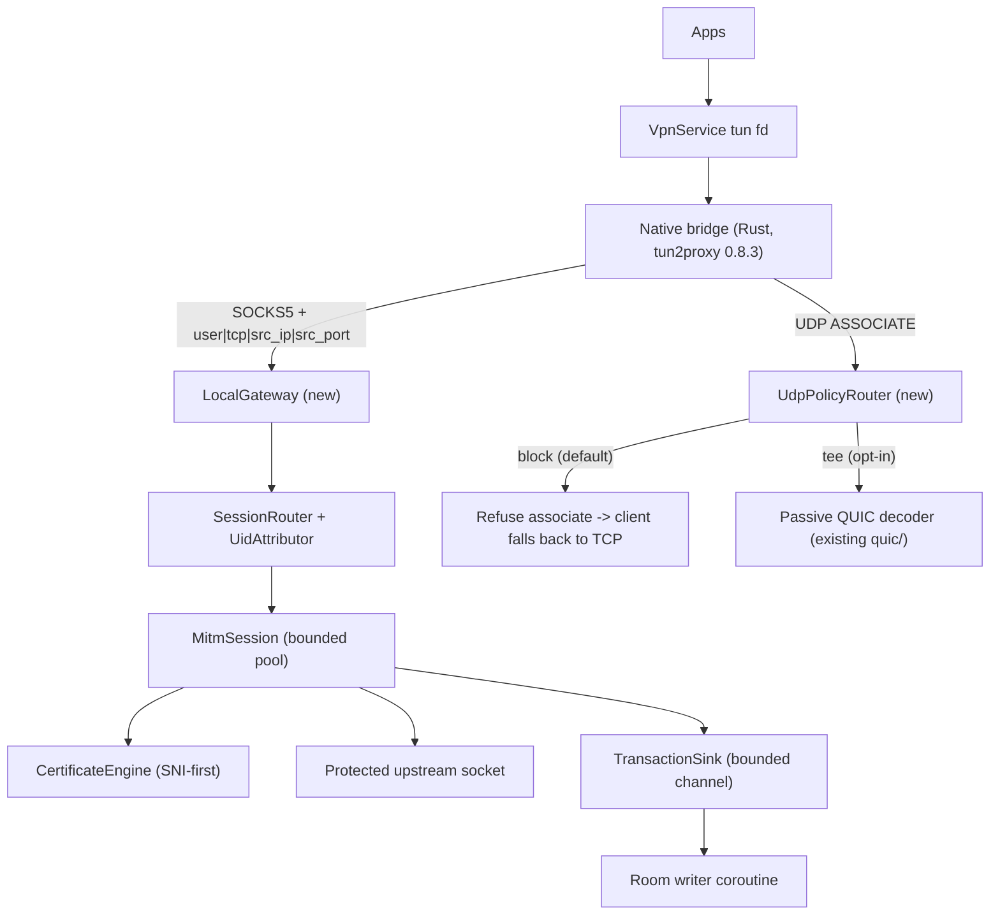

# Transport, Native Bridge, VPN Lifecycle, MITM/TLS, Trust and QUIC Policy Foundation

> **TL;DR:** requestr's capture path has a working tun and a working Rust bridge, but the bridge is wired as an HTTP-CONNECT proxy that silently drops all UDP (including DNS), the MITM front door only understands `CONNECT` (so the root/Shizuku and device-proxy tiers return `400 Bad Request` for real traffic), certificates are issued from the CONNECT authority before the ClientHello is even read, and relays use unbounded coroutines plus raw threads with `runBlocking` persistence — this plan rewrites the transport front door, the bridge protocol, the certificate engine, the QUIC policy, the root/Shizuku tiers and the trust diagnostics into one coherent, testable foundation.

## Scope

In scope: L1 transport (tun, native bridge, relay), VPN service lifecycle, the local gateway/listener, MITM/TLS termination and certificate issuance, CA trust and diagnostics, UID attribution, root/Shizuku/Frida tiers, and QUIC policy (block-or-tee).

Out of scope: rule engine, inspectors, export, scripting, replay, and UI screens (other than naming the surfaces that need design work). **Full advanced QUIC MITM is explicitly a later capability** and is never treated as a replacement for block-or-tee plus passive decode.

## Verified current behaviour

Everything below was read from source at `vorflux/fix-audit-gaps` @ `b71d61f`, not taken from the dossier.

| Area | Verified state |
|---|---|
| VPN FGS type | `specialUse` + `PROPERTY_SPECIAL_USE_FGS_SUBTYPE` in `AndroidManifest.xml`. **Correct — keep.** The dossier's `dataSync` advice is wrong and is overridden by this plan. |
| tun builder | `setSession`, `setMtu(1500)`, `addAddress(10.111.222.1/32)`, `addRoute("0.0.0.0",0)`, IPv6 address + `addRoute("::",0)` inside `runCatching`, `setMetered(false)` on API 29+. `onRevoke()` present. |
| tun builder gaps | No `setBlocking(true)`, no `setUnderlyingNetworks(...)`, no `NetworkCallback`, DNS servers are real public resolvers (`1.1.1.1`, `8.8.8.8`) rather than a virtual DNS IP in the tun pool. |
| Service start | `context.startService(...)` (not `startForegroundService`), and `startForeground` runs inside `scope.launch` after three suspending DataStore reads. |
| Native bridge config | `Tun2ProxyConfig.forMitmProxyEngine` = `ProxyType.HTTP` at `127.0.0.1:<mitmPort>`, `dnsMode = DIRECT`, `udpGw = null`, `ipv6Enabled = false`, `maxSessions = 200`. No session-info (`+info`) field exists in the Kotlin mirror or the Rust `BridgeConfig`. |
| Upstream tun2proxy 0.8.3 | `HttpManager::new_proxy_handler` returns `Err("Protocol not supported by HTTP proxy")` for any non-TCP session. `+info` is implemented only in `socks.rs::send_auth_data`, i.e. SOCKS5 with user/pass auth. |
| Consequence (confirmed) | In native-bridge mode **all UDP is dropped** — DNS/53 and QUIC 443 alike — and every TCP session arrives as `CONNECT <ip>:<port>` with no hostname, because `dnsMode = DIRECT` means no name ever reaches the proxy. |
| Native-bridge observability | `PacketPump.runNativeBridgeLoop` only polls byte counters; its own KDoc states no DNS/QUIC/PCAP/flow detail is recorded. The rich passive QUIC decode (`quic/` package, ~20 classes) is reachable **only** from the legacy `TunRelay` path. |
| Legacy path QUIC | `TunRelay` relays UDP/443 with no block, no tee decision and no user-visible fallback signal. |
| MITM front door | `MitmProxyEngine.handleClient` rejects anything that is not `CONNECT` with `400 Bad Request`. |
| Root tier | `PreflightController.run` selects `ROOT_IPTABLES` whenever `su` exists, before verifying it can work. `RootIptablesEngine` installs `REDIRECT` rules into the built-in `OUTPUT` chain, including a nonsensical UDP/443 redirect to a TCP port, and `stop()` never removes that UDP rule. Redirected connections have no `CONNECT` line and the proxy has no `SO_ORIGINAL_DST` support, so the whole tier answers `400` and breaks device traffic while armed. |
| Shizuku tier | Same `REDIRECT` approach with **no own-UID exclusion** (loop), no tun despite the class name, and a `Runtime.exec` fallback that cannot run `iptables` as the app UID. |
| Relay concurrency | One unbounded `launch` per accepted socket; two raw `Thread`s per relay with `join(60_000)`, whose timeout return emits a premature `MITM_DECRYPTED` row and leaks the threads. |
| Blocking on hot paths | `runBlocking` in `start()` CA prewarm, `persistConnectAttempt`, `generateHostCert`, `generateHostCertOrMirror`, plus `runBlocking` DB inserts in `RequestrVpnService`'s `onDecryptedTransaction` and `onDnsObserved`. |
| Certificate order | `certCache.getOrCompute(host)` runs at line ~307; `ClientHelloCapture.peekClientHello` runs at line ~316. The leaf is therefore minted from the CONNECT authority and the peeked SNI is used only for a JA3 hash. No upstream certificate sniffing. |
| Leaf hardening | `MitmProxyEngine.generateHostCert`: RSA-2048 per host, serial from `System.currentTimeMillis()`, 365-day validity, no `extendedKeyUsage=serverAuth`, no SKI, no AKI. `CertificateAuthority.issueLeafFromProfile` uses a random 64-bit serial but is also missing EKU/SKI/AKI. The two issuers disagree. |
| Cert cache | `ExpiringLruCertCache.getOrCompute` is `@Synchronized` on the whole instance while doing RSA-2048 keygen and (when mirroring is on) a blocking 5 s upstream handshake — head-of-line blocking across every host. |
| mTLS / custom certs | No `KeyManager` anywhere; `LazyUpstreamConnection` trusts everything via `AcceptAllTrustManager` and offers ALPN only on API 29+, while the client leg offers ALPN from API 24. No per-domain server-certificate or client-certificate support. |
| `protect()` coverage | Threaded only into `PacketPump` → `TunRelay`/`IcmpRelay`. Unprotected egress sockets: `LazyUpstreamConnection:41`, `RemoteCertificateMirror:59`, `HttpProxyShared:162` and `:245`, `ConnectReplay:109`. Loop avoidance currently relies on requestr being excluded from the tun, not on `protect()`. |
| Tests | 204 JVM unit tests (including `tun/`, `tls/`, `quic/` suites) and 34 Rust tests exist. `androidTest` contains only `ExampleInstrumentedTest.kt` — there is no instrumentation harness for the transport at all. |

## Target architecture

The single structural change that unlocks most of the rest: **the local listener stops being a CONNECT-only HTTP proxy and becomes a multi-protocol gateway** (SOCKS5 with user/pass, HTTP `CONNECT`, absolute-form HTTP, transparent TLS by SNI, transparent HTTP by `Host`). That one front door then serves the VPN/native-bridge tier, the manual device-proxy tier and the root/Shizuku transparent tier, instead of three half-wired paths.

## Proposed changes at a glance

| # | Change | Why |
|---|---|---|
| 1 | Bridge speaks SOCKS5 with `<user>+info` credentials; DNS mode, IPv6 and udpgw become explicit config | Restores UDP, recovers the real client 5-tuple, aligns `ipv6Enabled` with the `::/0` route |
| 2 | VPN lifecycle hardening: `setBlocking(true)`, `setUnderlyingNetworks`, `NetworkCallback` handoff, `startForegroundService` + immediate `startForeground`, process-wide `SocketProtector` | Survives Wi-Fi↔LTE handoff, removes background-start and FGS-timeout crashes, closes the `protect()` gaps |
| 3 | New `LocalGateway` multi-protocol listener; `MitmProxyEngine`/`HttpProxyEngine` demoted to session handlers | Fixes the `400 Bad Request` failure for every non-CONNECT tier |
| 4 | Bounded relay pool (32–64 permits), per-connection state machine, dedicated write dispatcher, bounded transaction channel, no `runBlocking` on relay paths | Removes thread leaks, the 60 s `join`, premature `MITM_DECRYPTED` rows and IO-dispatcher starvation |
| 5 | `CertificateEngine` rewrite: peek ClientHello **before** issuance, SNI-first host, upstream cert sniffing for IP/no-SNI CONNECTs, per-domain server-cert overrides, per-domain client certs (mTLS), hardened leaves (random serial with reserve, EKU serverAuth, SKI/AKI, ≤90-day validity), per-key locking | Correct certificates for IP CONNECTs and pinned/mTLS hosts; no global cache lock |
| 6 | QUIC policy layer: default **block** UDP/443 at the gateway, opt-in **tee** into the existing passive decoder, honest fallback badge and diagnostics row | Deterministic HTTP/2 fallback instead of silent drops; keeps advanced QUIC MITM out of scope |
| 7 | One `UidAttributor`: `+info` source tuple → `getConnectionOwnerUid` → `/proc/net/tcp` → allowlist inference, with an explicit `UNATTRIBUTED` state | Per-app attribution works in native-bridge mode, where the peer is tun2proxy's loopback socket today |
| 8 | Root/Shizuku rewrite: `SO_ORIGINAL_DST` via the existing native library, dedicated `REQUESTR_NAT` chain with idempotent install/verify/flush, `ip6tables`, symmetric teardown, own-UID exclusion on both tiers, real Shizuku user service, and preflight that **verifies before selecting** | Makes the two tiers either genuinely work or honestly unavailable, instead of auto-selecting a broken tier on any rooted device or emulator |
| 9 | `TrustDiagnostics`: per-store CA presence, Chromium/Chrome polarity, per-app `networkSecurityConfig` inspection, pinning-failure history, mTLS-required detection, QUIC-untrusted note; Frida engines consolidated | Replaces a boolean "trusted" with an explanation the user can act on |
| 10 | Instrumentation test harness plus a device/emulator validation matrix | There is currently no `androidTest` coverage of the transport at all |

## Key decisions taken in this plan

- **Keep `specialUse`** as the VpnService foreground-service type. Do not switch to `dataSync`.
- **Advanced QUIC MITM stays out of scope.** The deliverable is a *policy*: block by default, tee on request, passive decode where keys exist, always with a visible reason.
- **No silent mid-session tier switches.** A bridge failure degrades once, at start, with a recorded reason; it never flips transports underneath live flows.
- **Leaves become EC P-256 with a reused per-session key** and ≤90-day validity; the two divergent leaf issuers collapse into one.
- **`protect()` becomes mandatory** for every egress socket, enforced by a single `SocketProtector` seam, even though requestr is currently excluded from its own tun.
- **Rewrites over patches** where the current shape is the defect: the CONNECT-only listener, the raw-thread relay, the two certificate issuers, and both root/Shizuku engines are replaced, not amended.

## Blocking questions for the user

**Q1 — Bridge protocol and DNS mode.** This choice decides whether we get hostnames, UID attribution, or both.

| Option | Hostname source | UID attribution | Cost |
|---|---|---|---|
| **A (recommended)** SOCKS5 + `+info` + `dns = over_tcp` | ClientHello SNI / `Host` header, plus DNS visible as TCP/53 through the gateway | Full — real destination IP is in the SOCKS5 request, source tuple in `+info` | Non-TLS, non-HTTP flows stay IP-only |
| B SOCKS5 + `+info` + `dns = virtual` | Always — tun2proxy passes the domain in the SOCKS5 request | Degraded — the destination the app dialled is a synthetic `198.18.0.0/15` IP the gateway never learns | Loses `getConnectionOwnerUid` |
| C Vendor a patched tun2proxy fork with a per-session callback | Always | Full | Ongoing fork maintenance and a pinned git dependency |
| D Status quo (HTTP proxy, `dns = direct`) | None (IP literals) | None | Zero work, keeps UDP and DNS broken |

**Q2 — Root/Shizuku tiers.** Both are currently auto-selected and non-functional.

- Option A (recommended): full rewrite with `SO_ORIGINAL_DST` transparent-proxy support in the native library.
- Option B: gate both tiers off behind a verified-capability check now, ship the rewrite later. Cheaper, but leaves the app's highest-fidelity tiers advertised-but-absent.
- Option C: remove the tiers entirely.

**Q3 — Legacy `TunRelay` path.** It is the only path that currently feeds the passive QUIC/DNS/PCAP decoders, and it duplicates the bridge.

- Option A (recommended): keep it as the explicit degraded fallback and add a datagram tee so the passive decoders work in *both* modes.
- Option B: retire it and rely solely on the native bridge, accepting that a bridge failure means no capture at all.
- Option C: keep it as the default and treat the native bridge as opt-in.

## UI/design handoff

New or changed user-facing surfaces implied by this plan: capture-tier diagnostics (why a tier is unavailable), QUIC blocked/tee badge with a fallback explanation, trust diagnostics panel, and per-domain certificate/mTLS configuration. The main agent should dispatch a design subagent for these and attach Design-tab artifacts; no mockups are produced here.
